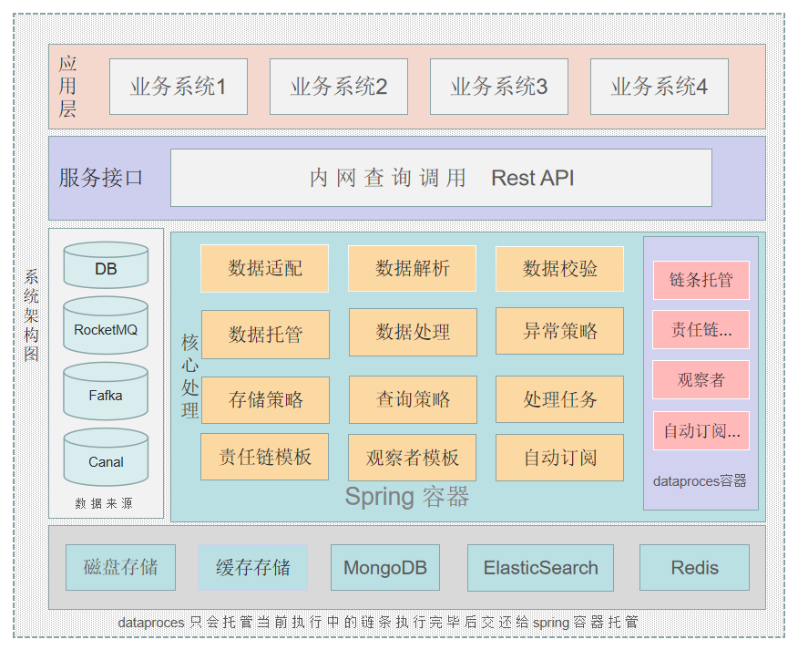
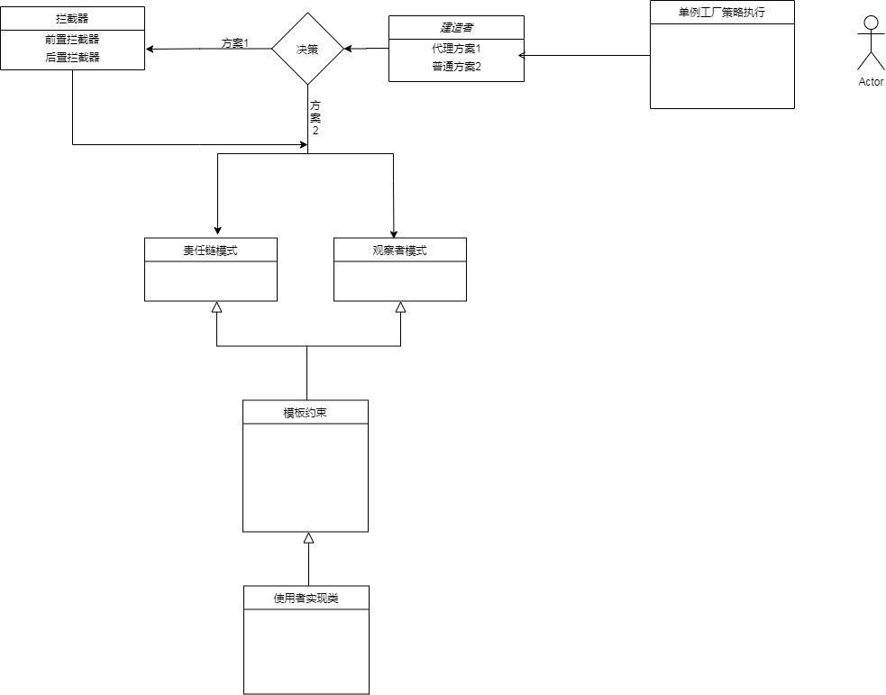

<div align="center">

# 🗃️ DataProcess

**基于 SpringBoot 的数据库变更同步中间件**

监听 MySQL 变更 → Canal + RocketMQ 投递 → 责任链 / 监听器双模式处理 → 实时同步 Redis 缓存 & ElasticSearch

[](LICENSE)
[](https://adoptium.net/)
[](https://spring.io/projects/spring-boot)
[](https://www.mysql.com/)
[](https://github.com/alibaba/canal)
[](https://rocketmq.apache.org/)
[](https://www.elastic.co/)
[](https://redis.io/)

[](https://maven.apache.org/)
[](#-内部设计模式)
[](#-数据同步链路)
[](https://gitee.com/lang_junnan/dataprocess-spring-boot-starter)

</div>

---

## 🧭 目录

- [✨ 项目初衷](#-项目初衷)
- [🔄 数据同步链路](#-数据同步链路)
- [🏛️ 系统架构](#️-系统架构)
- [🧩 DataProcess 角色](#-dataprocess-角色)
- [🧠 内部设计模式](#-内部设计模式)
- [🎯 两种模式如何选择](#-两种模式如何选择)
- [🛠️ 技术栈](#-技术栈)
- [📦 快速开始](#-快速开始)
- [📁 包结构](#-包结构)
- [🤝 贡献 & 社区](#-贡献--社区)

---

## ✨ 项目初衷

随着业务系统不断迭代，数据库数据量持续增大，日常运行中不少接口查询缓慢，甚至读取超时。为整体优化项目、提高系统性能，希望在系统中对部分业务充分利用**缓存**或 **ElasticSearch 搜索引擎**实现高效查询。

由此引出一个核心问题：**数据如何实时同步到 ES、Redis 或其他容器中？**

`dataprocess` 帮助你实时计算数据报表、充分利用计算能力，解决企业项目中常见的一部分数据同步与查询疑难场景。该架构在合理使用下，天然规避了 **Redis 缓存雪崩、缓存穿透**等问题，具体效果取决于使用方式。

---

## 🔄 数据同步链路

搜索业务、缓存读取对数据实时性要求很高，因此本项目采用阿里开源的 **Canal** 监听关系型数据库主库（如 `MySQL-Master`），实时读取数据库操作日志变更。Canal 相当于关系型数据库的从库（Slave），经过多次迭代已非常成熟。

Canal 自身集成了 **RocketMQ** 与 **Kafka**，可将订阅的数据库日志直接投递到 MQ，使用者只需监听 MQ 消息队列即可。**本项目集成的是 RocketMQ。**

```
┌──────────┐   binlog   ┌─────────┐   MQ    ┌───────────┐   责任链/监听器   ┌──────────────┐
│  MySQL   │ ─────────► │  Canal  │ ──────► │ RocketMQ  │ ──────────────► │ DataProcess  │
│  Master  │            │ (Slave) │         │           │                 │  核心处理引擎  │
└──────────┘            └─────────┘         └───────────┘                 └──────┬───────┘
                                                                                 │
                                                            ┌────────────────────┴────────────┐
                                                            ▼                                 ▼
                                                     ┌────────────┐                    ┌──────────────┐
                                                     │   Redis    │                    │ ElasticSearch│
                                                     │   缓存      │                    │   搜索引擎    │
                                                     └────────────┘                    └──────────────┘
```

---

## 🏛️ 系统架构

**系统架构图 1**


**系统架构图 2**



**内部依赖图**



---

## 🧩 DataProcess 角色

`DataProcess` 主要负责：**监听数据来源 → 适配数据源 → 解析数据 → 校验数据 → 托管代理本次执行的数据**，随后创建执行责任链，或订阅监听器模式。两种模式任选其一即可实现业务逻辑，由使用者自行定义。

### 两种扩展模板

| 模式 | 实现模板 | 适用场景 |
|---|---|---|
| 🔗 **责任链模式** | `ChainTemplate` | 按处理过程选择加工对象，可动态决定是否执行下一个处理器 |
| 👂 **监听器（观察者）模式** | `ObserverTemplate` | 每次变更都必须通知到全部处理器 |

### 对外开放的接口能力

两种模式均对外提供以下能力：

| 能力 | 接口 |
|---|---|
| ➕ 新增 | `insertData` |
| ✏️ 修改 | `updateData` |
| ❌ 删除 | `deleteData` |
| 🔁 回滚 | `insertDataRollBack` / `updateDataRollBack` / `deleteDataRollBack` |
| 🔍 创建索引 / ⚠️ 异常捕获 | 模板内置 |
| 🛡️ 前置 / 后置拦截器 | **默认不开启**，可在配置文件中自行设置 |

### 包扫描与管理机制

- 只要实现了 `ChainTemplate` 责任链模板，或实现了 `ObserverTemplate` 监听器模板，且位于 `com.dataprocess.databases.某个库包.某个表包` 下，对应实现类就会自动形成一条链，或被监听器通知到。
- 当前执行的链条 / 监听器由 **DataProcess 与 Spring 共同管理**；未执行的链条 / 监听器类由 Spring 自身管理。
- 所谓"当前执行链条 / 观察类"：监听到某个库、某张表中的某一批或一条记录发生变更时，针对当前数据表的链条 / 观察类会被 DataProcess 执行。
- 每个链条 / 监听器实现类都开放了新增、修改、删除、异常捕获、拦截器等接口。使用者只需专注实现自己关心的新增、删除、修改、异常记录等业务功能。
- 此外，DataProcess 还提供了**缓存查询**与 **ElasticSearch 复杂查询**案例展示。

---

## 🧠 内部设计模式

DataProcess 在架构层面系统运用了多种经典设计模式，把"数据监听 → 适配 → 解析 → 校验 → 执行 → 回滚"的流程拆成可插拔、可扩展的独立单元，使用者只需聚焦业务处理器，无需改动核心流程。

<div align="center">

[](#-内部设计模式)
[](#-内部设计模式)
[](#-内部设计模式)
[](#-内部设计模式)
[](#-内部设计模式)
[](#-内部设计模式)
[](#-内部设计模式)
[](#-内部设计模式)
[](#-内部设计模式)
[](#-内部设计模式)

</div>

| 设计模式 | 项目内落地体现 | 对应包 / 模板 |
|---|---|---|
| 🔗 **责任链模式** | 处理器沿链条依次执行，可动态决定是否调用下一个处理器，并支持每一步回滚 | `core.handler`、`ChainTemplate` |
| 👂 **观察者（监听器）模式** | 表数据变更后自动订阅并通知全部监听器，各自独立处理 | `core.subject`、`ObserverTemplate` |
| 📐 **模板方法模式** | 抽象模板固定处理骨架（新增 / 修改 / 删除 / 回滚），具体步骤由子类实现 | `core.template` |
| 🏗️ **建造者模式** | 通过不同 Builder 组装执行链路，区分普通模式与代理模式 | `core.builder`：`OrdinaryBuilder` / `ProxyBuilder` |
| 🏭 **工厂模式** | 统一创建处理器、链条与监听器实例，屏蔽对象构造细节 | `core.factory` |
| 🧮 **策略模式** | 按数据类型 / 处理场景选择对应处理策略 | `core.factory`（策略处理） |
| 🔌 **适配器模式** | 预留数据源适配器扩展位，适配不同来源的数据结构 | `core.adapter`（预留扩展） |
| 🛡️ **代理模式** | 代理构建者托管执行类，统一包裹前置 / 后置拦截与生命周期管理 | `ProxyBuilder`、`core.interceptor` |
| 🚧 **拦截器思想** | 前置拦截器 `ProxyBefore`、后置拦截器 `ProxyAfter`，在业务执行前后插入校验与增强逻辑 | `core.interceptor`、`interceptor` |
| 🔁 **补偿 / 回滚思想** | 每个写操作都对应 RollBack 方法，失败时按链 / 监听器逆向补偿 | 各模板的 `*RollBack` 方法 |

> 上述模式相互配合：**模板方法**定义处理骨架，**责任链 / 观察者**组织执行顺序，**工厂 + 策略**选择实现，**建造者**装配整体结构，**代理 + 拦截器**统一增强，**适配器**预留扩展，**回滚**保障失败补偿。

### 模式如何支撑业务扩展

- 🆕 **新增一张表的处理逻辑**：只需在 `databases.库名.表名` 包下实现对应模板类，框架自动纳入链条 / 监听器；
- 🧩 **新增一种处理策略**：在工厂 / 策略位扩展即可，不改动既有处理器；
- 🛡️ **统一加前置校验或后置记录**：通过代理拦截器统一挂载，无需侵入每个业务类；
- ↩️ **执行失败需要撤销**：调用对应 `RollBack` 方法完成补偿。

---

## 🎯 两种模式如何选择

| | 🔗 责任链方式 | 👂 观察者方式 |
|---|---|---|
| **关注点** | 更注重**过程** | 注重**通知** |
| **执行控制** | 按环节选择加工对象，可动态判断是否执行下一个处理器 | 每次变更必须通知到全部处理器 |
| **适用场景** | 多阶段流水线加工 | 一对多广播式同步 |

---

## 🛠️ 技术栈

<div align="center">

| ☕ Java | 🌱 SpringBoot | 🐬 MySQL | 🛰️ Canal |
|:---:|:---:|:---:|:---:|
|  |  |  |  |
| JDK 1.8 | 2.6.2 | 5.5 | deployer-1.1.5 |

| 📨 RocketMQ | 🔍 ElasticSearch | 🧱 Redis | 📦 Maven |
|:---:|:---:|:---:|:---:|
|  |  |  |  |
| all-4.3.0 | 7.16.2 | 5.0.14 | 3.x |

</div>

| 类别 | 版本 / 技术 |
|---|---|
| ☕ JDK | 1.8 |
| 🐬 MySQL | 5.5 |
| 🛰️ Canal | deployer-1.1.5 |
| 📨 RocketMQ | all-4.3.0-bin-release |
| 🔍 ElasticSearch | 7.16.2（windows-x86_64） |
| 🧱 Redis | x64-5.0.14 |
| 🌱 SpringBoot | 2.6，集成 ES & Redis 做 CRUD |
| 🔎 ES 复杂查询 | SpringBoot 2.6 集成 ElasticSearch 复杂查询案例 |

---

## 📦 快速开始

### 系统安装依赖

1. 📥 相关的资源地址：[https://pan.baidu.com/s/18V38e4h9_BncyqYu1yp2BA](https://pan.baidu.com/s/18V38e4h9_BncyqYu1yp2BA)（提取码：`1234`）
2. ✅ 准备环境：本地必备条件应安装好 JDK 1.8 并配置好环境变量
3. 📖 以下安装链接为个人博客园提供，描述比较简单，不保证您也能这么畅通，相信你也能遇到问题解决问题：
   - 🔍 下载 ElasticSearch 并配置 → [博客教程](https://www.cnblogs.com/langjunnan/articles/15798379.html)
   - 🛰️ 下载 Canal 到本地并配置 → [博客教程](https://www.cnblogs.com/langjunnan/articles/15798583.html)
   - 📨 下载 RocketMQ 并配置 → [博客教程](https://www.cnblogs.com/langjunnan/articles/15798518.html)
   - 🧱 下载 Redis 并启动 → [博客教程](https://www.cnblogs.com/langjunnan/articles/15798670.html)
4. 🚀 下载 dataprocess（当前项目）到本地，找到 SpringBoot 运行类，点击运行
5. 🎉 成功案例介绍 → [博客教程](https://www.cnblogs.com/langjunnan/articles/15799285.html)

### 使用说明

1. `dataprocess` 为使用者提供了两种方案：**① 监听器模式方案　② 责任链模式方案**，使用者只需实现一种方案完成业务即可。
2. 在 `resources` 文件夹下配置修改 `application.properties`、`application.yml` 两个文件中的 RocketMQ、Redis、ES 信息。
3. 创建包 `com.dataprocess.databases.*.*`：第一个 `*` 换成你想要连接的数据库名称，第二个 `*` 换成库下的表名。
4. **监听器模式方案**：在 `com.dataprocess.databases.*.*` 包下创建任意数量的类，实现 `ObserverTemplate` 抽象类。这些类会自动订阅当前表的动态，并提供 `insertData`、`updateData`、`deleteData` 及对应回滚方法 `insertDataRollBack`、`updateDataRollBack`、`deleteDataRollBack`。
5. **责任链模式方案**：在 `com.dataprocess.databases.*.*` 包下创建任意数量的类，实现 `ChainTemplate` 抽象类。这些类会被系统所管理，由使用者决定是否执行下一个类，伪代码如下：

   ```java
   result = getNext().insertData(obj);
   // 或者在做好某个类业务点包装下一个请求参数再去执行下一个类
   ```

   该类同样提供 `insertData`、`updateData`、`deleteData` 及对应回滚方法。

6. 🛡️ **代理构建者与拦截器**：DataProcess 默认建造的是 `OrdinaryBuilder` 构建者，同时也为你准备了代理构建者 `ProxyBuilder`。使用代理构建者可以开启拦截器功能——拦截器提供了前置拦截器 `ProxyBefore` 和后置拦截器 `ProxyAfter`，使用者只需编写实现类实现拦截器接口，即可实现自己的业务功能。

7. ⚙️ 是否开启代理构建者可在 `application.properties` 中配置：

   ```properties
   open.proxy=false    # 默认不开启代理模式，拦截器功能也不会开启
   ```

   > ⚠️ **注意**：开启代理模式后，所有继承 `ChainTemplate`、`ObserverTemplate` 抽象类的实现类中的属性**必须要有 GET / SET 方法**，否则运行会出现意想不到的错误。因为当前所有类由 DataProcess 代理，本次执行的所有类都由 Spring 和 DataProcess 同时管理，具体管理用到了浅 Copy，所以必须给所有属性加上 GET / SET 方法。

8. 🔎 ES 相关的查询服务可以在 `com.dataprocess.es` 下编写。
9. 🚀 找到 `DataProcessApplication` 类启动，确保项目能启动并且控制台不报错。

---

## 📁 包结构

```text
com.dataprocess
├── common                 # 业务工具类，使用者可在该包下创建工具类
├── core                   # 核心包，非架构层面修改不建议改动
│   ├── adapter            # 适配器类扩展（目前暂未做适配）
│   ├── builder            # 方案建造者
│   ├── common             # 核心工具类
│   ├── factory            # 核心工厂 / 策略处理
│   ├── interceptor        # 前置、后置核心拦截器
│   ├── handler            # 核心托管代理处理
│   ├── subject            # 监听器订阅的主题
│   └── template           # 核心模板：责任链模板、监听器模板
├── databases              # 数据业务处理包，专门面向使用者开放
│   └── *.*                # 第一个 * = 数据库名称，第二个 * = 数据表名称
│                          # 按规范在表名包下创建过滤器类，实现模板约束后进行业务操作
│       └── bpm.merchant   # Demo：bpm 包对应 MySQL 中 bpm 库，merchant 为 bpm 库下的表
├── es                     # ElasticSearch 相关
│   ├── api                # ES 对外查询接口，附带复杂查询案例
│   ├── dao                # ES 数据层操作
│   ├── entity             # ES 实体（文档）
│   └── index              # ES 文档索引
├── init                   # 初始化 ES 索引
├── interceptor            # 面向使用者提供的拦截器包
├── mq                     # 监听 RocketMQ 推送的消息
└── redis                  # Redis 配置相关信息
```

---

## 🤝 贡献 & 社区

### 贡献代码（欢迎您的加入）

如果你有兴趣参与项目开发，请联系我个人邮箱：**1419052183@qq.com**。

<div align="center">

[](mailto:1419052183@qq.com)
[](https://gitee.com/lang_junnan/dataprocess-spring-boot-starter)

</div>

> 编码不易，如果觉得对您有帮助请点一下 **Star** ⭐，同时也接受您宝贵的建议与批评，谢谢！

### 交流社区群


### Maven 快速接入

📖 请阅读 → [dataprocess-spring-boot-starter](https://gitee.com/lang_junnan/dataprocess-spring-boot-starter)

---

<div align="center">

**⭐ 如果这个项目对您有帮助，请给个 Star 支持一下！**

Made with ❤️ by langjunnan

</div>
