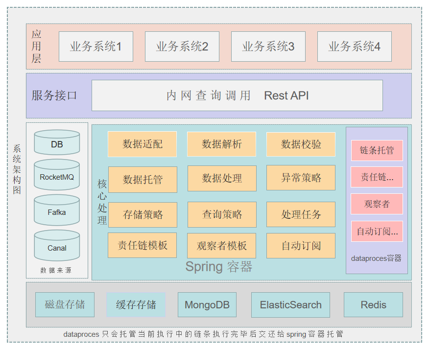

 **dataprocess简介** 
 
   **项目初衷：** 
        随着业务系统的不断迭代，数据库的数据量也随着逐渐增大，就导致业务系统日常运行情况下很多接口查询请求缓慢，
     甚至读取超时 ,为了整体优化项目，提高系统性能 希望在系统中对于部分业务充分利用缓存操作或使用ElasticSearch
     搜索引擎来高效率的查询 那么问题来了，数据如何同步到ES，Redis或其他的容器中呢

   **数据同步：** 
        既然是搜索业务，读取缓存 那么对数据的实时性要求一定很高，所以这里我们使用 阿里巴巴开源的Canal让它去监听
    我们关系型数据库的主库例如 MySql-Master，实时读取数据库操作日志的变更，Canal就相当于关系型数据库的从库Slave，
    Canal经过很多次迭代已经很成熟了，Canal自身又对RocketMq和kafka做了集成 可以把数据库订阅的日志直接输送到我们MQ当中，
    使用者只需要去监听MQ的消息队列即可，本次项目集成的是RocketMQ
   
   **dataprocess角色：** 
        Mysql-》Canal-》RocketMQ-》dataproces处理{过滤器1处理ES 增 删 改 索引 回滚 异常--过滤器2处理 Redis 增 删 改
    回滚 索引 异常...}
    dataprocess主要充当着监听数据来源 适配数据源 解析数据 检验数据 托管数据 然后创建执行责任链，
    责任链条是由使用者自己去定义的，只要编写的类实现了CoreTemplate模板并且是在com.dataprocess.databases.某个库包下的
    表包下的所有实现类都会形成一条链，当前执行的链条是可以被dataprocess和Spring共同来管理的，没有执行的链条由Spring
    自己来管理，所谓的当前执行链条就是监听到某个库中的某个表中的某一批或一条记录发生了变更，针对当前数据表的链条是会
    被dataprocess来执行的，每个链条的实现类都对外开放了一些接口方法 例如:  添加 修改 删除 创建索引 异常捕获等操作，当某个
    表发生了变化，就会以过滤链的形式给使用者提供了 添加/修改/删除 接口方法，使用者只需要 专注去做自己想要做的添加功能
    删除功能  修改功能  异常记录功能 就可以了，另外dataproces也提供了缓存查询 和 ElasticSearch 复杂查询案例展示
    
 **项目涉及到的技术点：**  
  1. 基础环境 jdk1.8
  2. MySQL 5.5
  3. Canal.deployer-1.1.5  
  4. RocketMQ-all-4.3.0-bin-release
  5. ElasticSearch-7.16.2-windows-x86_64     
  6. Redis-x64-5.0.14
  7. SpringBoot2.6 集成ElasticSearch & Redis做CRUD
  8. SpringBoot2.6 集成ElasticSearch 复杂查询案例

 
**系统结构**
    
    com.dataprocess.common ###  业务工具类 使用者可在该包下创建工具类
 
    com.dataprocess.core  ### 核心包 如果不是对项目结构，架构层面修改的代码  不建议修改该包下的代码
    
    com.dataprocess.core.adapter ### 适配器类得扩展目前并没有做适配

    com.dataprocess.core.common ### 核心工具类

    com.dataprocess.core.factory ### 核心工厂 策略处理 和 Spring托管

    com.dataprocess.core.handler ### 核心托管代理处理
    
    com.dataprocess.core.template### 核心模板

    com.dataprocess.databases ### 数据业务处理包 该包是专门为使用者提供的

    ### 该包下的第一个*包是数据库名称 第二个*包是数据表名称，使用者应 按照规范
    ### 在当前表名包下创建过滤器类 实现CoreTemplate约束 进行后续业务操作
    com.dataprocess.databases.*.*  

    ###demo案例 godnan包是MySql中bpm库，merchant包是bpm库下的merchant表 
    com.dataprocess.databases.bpm.merchant

    com.dataprocess.es.api ### es接口对外提供的查询， 附带复杂查询案例 

    com.dataprocess.es.dao ### es 到层面的操作

    com.dataprocess.es.entity ### es 涉及到实体 也叫文档
    
    com.dataprocess.es.index  ### es 文档索引
    
    com.dataprocess.init ###初始化 es索引

    com.dataprocess.mq ### 监听rocketmq推送的消息

    com.dataprocess.redis  ###redis 配置相关信息
**系统架构图1** 

 
 
**系统架构图2** 

 
 
**系统安装依赖** 
1.  相关的资源地址: 链接：https://pan.baidu.com/s/18V38e4h9_BncyqYu1yp2BA   提取码：1234
2.  准备环境 必备条件本地应安装好jdk1.8 并且配置好环境变量
3.  以下安装链接是我个人博客园提供，描述比较简单，不保证您也能这么畅通，相信你也能遇到问题解决问题
3.  下载ElasticSearch并配置 https://www.cnblogs.com/langjunnan/articles/15798379.html
4.  下载Canal到本地并配置 https://www.cnblogs.com/langjunnan/articles/15798583.html
5.  下载RocketMQ并配置 https://www.cnblogs.com/langjunnan/articles/15798518.html
6.  下载Redis并启动 https://www.cnblogs.com/langjunnan/articles/15798670.html
7.  下载dataprocess也就是当前项目到本地，并且找到SpringBoot的运行类 点击运行
8.   成功案例介绍:    https://www.cnblogs.com/langjunnan/articles/15799285.html

**使用说明说** 

1. 在resources文件夹下 配置修改application.properties，application.yml两个文件的信息RocketMQ，Redis，Es配置
2. com.dataprocess.databases.*.*  第一个*包 换成你想要连接数据库的名称 第二个*包换成库下的表名，然后随便创建一个类
该类需要继承 CoreTemplate 类并且实现该类得子方法 该类要加上 @Component注解 由Spring容器管理 ，使用者可以重写 CoreTemplate父类 下的 
insert update delete 方法 实现自己的逻辑，还有对应得异常处理方法，如果某个实现类中出现了异常则系统默认调用对应得异常方法
，只要是在该包下创建的类，会形成一条责任链来执行 ，配合完成使用者想要实现的业务逻辑。
3. 重点要注意得是 所有实现了CoreTemplate 抽象类得子类里面得属性 必须要又GET SET 方法，否则运行则会出现意想不到得错误，
因为当前责任链链条在执行得同时，该链条上得所有类都是由Spring 和dataprocess 同时进行管理得，具体管理用到了浅Copy所以
必须要给所有属性加上GET　SET方法
4. es 相关的查询服务 可以在 com.dataprocess.es 下编写
5. 找到DataProcessApplication类启动  确保项目能启动并且控制台不报错

**贡献代码（欢迎您的加入）** 

如果你有兴趣参与项目开发，请联系我个人邮箱: 1419052183@qq.com   编码不易 如果觉得对您有帮助请点一下Star 
同时 也接受您宝贵的建议  接受批评   谢谢！

**交流社区群** 

 
 
