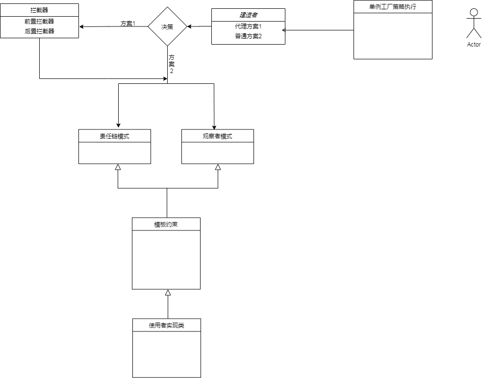

# 🗃️ DataProcess

> 基于 **SpringBoot 2.6** 的数据库变更同步中间件：监听 MySQL 变更 → 经 Canal + RocketMQ 投递 → 通过**责任链 / 监听器**两种模式处理数据，同步到 **Redis 缓存**与 **ElasticSearch** 搜索引擎，提升业务查询性能。

## ✨ 项目初衷

随着业务系统不断迭代，数据库数据量持续增大，日常运行中不少接口查询缓慢，甚至读取超时。为整体优化项目、提高系统性能，希望在系统中对部分业务充分利用**缓存**或 **ElasticSearch 搜索引擎**实现高效查询。

由此引出一个核心问题：**数据如何实时同步到 ES、Redis 或其他容器中？**

`dataprocess` 帮助你实时计算数据报表、充分利用计算能力，解决企业项目中常见的一部分数据同步与查询疑难场景。该架构在合理使用下，天然规避了 **Redis 缓存雪崩、缓存穿透**等问题，具体效果取决于使用方式。

## 🔄 数据同步链路

搜索业务、缓存读取对数据实时性要求很高，因此本项目采用阿里开源的 **Canal** 监听关系型数据库主库（如 `MySQL-Master`），实时读取数据库操作日志变更。Canal 相当于关系型数据库的从库（Slave），经过多次迭代已非常成熟。

Canal 自身集成了 **RocketMQ** 与 **Kafka**，可将订阅的数据库日志直接投递到 MQ，使用者只需监听 MQ 消息队列即可。**本项目集成的是 RocketMQ。**


## 🧩 DataProcess 角色

`DataProcess` 主要负责：**监听数据来源 → 适配数据源 → 解析数据 → 校验数据 → 托管代理本次执行的数据**，随后创建执行责任链，或订阅监听器模式。两种模式任选其一即可实现业务逻辑，由使用者自行定义。

### 两种扩展模板

| 模式 | 实现模板 | 适用 |
|---|---|---|
| 🔗 **责任链模式** | `ChainTemplate` | 按处理过程选择加工对象，可动态决定是否执行下一个处理器 |
| 👂 **监听器（观察者）模式** | `ObserverTemplate` | 每次变更都必须通知到全部处理器 |

### 对外开放的接口能力

两种模式均对外提供以下能力：

- ➕ 新增（`insertData`）/ ✏️ 修改（`updateData`）/ ❌ 删除（`deleteData`）
- 🔁 对应回滚方法：`insertDataRollBack`、`updateDataRollBack`、`deleteDataRollBack`
- 🔍 创建索引、⚠️ 异常捕获
- 🛡️ 前置拦截器、后置拦截器（**默认不开启**，可在配置文件中自行设置）

### 包扫描与管理机制

- 只要实现了 `ChainTemplate` 责任链模板，或实现了 `ObserverTemplate` 监听器模板，且位于 `com.dataprocess.databases.某个库包.某个表包` 下，对应实现类就会自动形成一条链，或被监听器通知到。
- 当前执行的链条 / 监听器由 **DataProcess 与 Spring 共同管理**；未执行的链条 / 监听器类由 Spring 自身管理。
- 所谓"当前执行链条 / 观察类"：监听到某个库、某张表中的某一批或一条记录发生变更时，针对当前数据表的链条 / 观察类会被 DataProcess 执行。
- 每个链条 / 监听器实现类都开放了新增、修改、删除、异常捕获、拦截器等接口。使用者只需专注实现自己关心的新增、删除、修改、异常记录等业务功能。
- 此外，DataProcess 还提供了**缓存查询**与 **ElasticSearch 复杂查询**案例展示。

## 🧠 内部设计模式

DataProcess 在架构层面系统运用了多种经典设计模式，把"数据监听 → 适配 → 解析 → 校验 → 执行 → 回滚"的流程拆成可插拔、可扩展的独立单元，使用者只需聚焦业务处理器，无需改动核心流程。

| 设计模式 | 项目内落地体现 | 对应包 / 模板 |
|---|---|---|
| 🔗 **责任链模式** | 处理器沿链条依次执行，可动态决定是否调用下一个处理器，并支持每一步回滚 | `core.handler`、`ChainTemplate` |
| 👂 **观察者（监听器）模式** | 表数据变更后自动订阅并通知全部监听器，各自独立处理 | `core.subject`、`ObserverTemplate` |
| 📐 **模板方法模式** | 抽象模板固定处理骨架（新增 / 修改 / 删除 / 回滚），具体步骤由子类实现 | `core.template` |
| 🏗️ **建造者模式** | 通过不同 Builder 组装执行链路，区分普通模式与代理模式 | `core.builder`：`OrdinaryBuilder` / `ProxyBuilder` |
| 🏭 **工厂模式** | 统一创建处理器、链条与监听器实例，屏蔽对象构造细节 | `core.factory` |
| 🧮 **策略模式** | 按数据类型 / 处理场景选择对应处理策略 | `core.factory`（策略处理） |
| 🔌 **适配器模式** | 预留数据源适配器扩展位，适配不同来源的数据结构 | `core.adapter`（预留扩展） |
| 🛡️ **代理模式** | 代理构建者托管执行类，统一包裹前置 / 后置拦截与生命周期管理 | `ProxyBuilder`、`core.interceptor` |
| 🚧 **拦截器思想** | 前置拦截器 `ProxyBefore`、后置拦截器 `ProxyAfter`，在业务执行前后插入校验与增强逻辑 | `core.interceptor`、`interceptor` |
| 🔁 **补偿 / 回滚思想** | 每个写操作都对应 RollBack 方法，失败时按链 / 监听器逆向补偿 | 各模板的 `*RollBack` 方法 |

> 上述模式相互配合：**模板方法**定义处理骨架，**责任链 / 观察者**组织执行顺序，**工厂 + 策略**选择实现，**建造者**装配整体结构，**代理 + 拦截器**统一增强，**适配器**预留扩展，**回滚**保障失败补偿。

### 模式如何支撑业务扩展

- 新增一张表的处理逻辑：只需在 `databases.库名.表名` 包下实现对应模板类，框架自动纳入链条 / 监听器；
- 新增一种处理策略：在工厂 / 策略位扩展即可，不改动既有处理器；
- 统一加前置校验或后置记录：通过代理拦截器统一挂载，无需侵入每个业务类；
- 执行失败需要撤销：调用对应 `RollBack` 方法完成补偿。


## 🎯 两种模式如何选择

- **责任链方式**：如果你的需求更注重**过程**、需要按环节选择加工对象，推荐使用责任链，可根据处理需求动态判断是否执行下一个处理器。
- **观察者方式**：如果每次变更都**必须通知到全部处理器**，观察者（监听器）模式是更好的选择。

## 🛠️ 技术栈

| 类别 | 版本 / 技术 |
|---|---|
| ☕ JDK | 1.8 |
| 🐬 MySQL | 5.5 |
| 🛰️ Canal | deployer-1.1.5 |
| 📨 RocketMQ | all-4.3.0-bin-release |
| 🔍 ElasticSearch | 7.16.2（windows-x86_64） |
| 🧱 Redis | x64-5.0.14 |
| 🌱 SpringBoot | 2.6，集成 ES & Redis 做 CRUD |
| 🔎 ES 复杂查询 | SpringBoot 2.6 集成 ElasticSearch 复杂查询案例 |

## 📁 包结构

```text
com.dataprocess.common            # 业务工具类，使用者可在该包下创建工具类

com.dataprocess.core              # 核心包，非架构层面修改不建议改动
├── adapter                       # 适配器类扩展（目前暂未做适配）
├── builder                       # 方案建造者
├── common                        # 核心工具类
├── factory                       # 核心工厂 / 策略处理
├── interceptor                   # 前置、后置核心拦截器
├── handler                       # 核心托管代理处理
├── subject                       # 监听器订阅的主题
└── template                      # 核心模板：责任链模板、监听器模板

com.dataprocess.databases         # 数据业务处理包，专门面向使用者开放
└── *.*                           # 第一个 * = 数据库名称，第二个 * = 数据表名称
                                  # 按规范在表名包下创建过滤器类，实现模板约束后进行业务操作
    └── bpm.merchant              # Demo：godnan 包对应 MySQL 中 bpm 库，merchant 为 bpm 库下的表

com.dataprocess.es
├── api                           # ES 对外查询接口，附带复杂查询案例
├── dao                           # ES 数据层操作
├── entity                       # ES 实体（文档）
└── index                         # ES 文档索引

com.dataprocess.init              # 初始化 ES 索引
com.dataprocess.interceptor       # 面向使用者提供的拦截器包
com.dataprocess.mq                # 监听 RocketMQ 推送的消息
com.dataprocess.redis             # Redis 配置相关信息
```
**系统架构图1** 

 
 
**系统架构图2** 

 

**内部依赖图**

 

**系统安装依赖** 
1.  相关的资源地址: 链接：https://pan.baidu.com/s/18V38e4h9_BncyqYu1yp2BA   提取码：1234
2.  准备环境 必备条件本地应安装好jdk1.8 并且配置好环境变量
3.  以下安装链接是我个人博客园提供，描述比较简单，不保证您也能这么畅通，相信你也能遇到问题解决问题
3.  下载ElasticSearch并配置 https://www.cnblogs.com/langjunnan/articles/15798379.html
4.  下载Canal到本地并配置 https://www.cnblogs.com/langjunnan/articles/15798583.html
5.  下载RocketMQ并配置 https://www.cnblogs.com/langjunnan/articles/15798518.html
6.  下载Redis并启动 https://www.cnblogs.com/langjunnan/articles/15798670.html
7.  下载dataprocess也就是当前项目到本地，并且找到SpringBoot的运行类 点击运行
8.   成功案例介绍:    https://www.cnblogs.com/langjunnan/articles/15799285.html

**使用说明说**
1. dataprocess 为使用者提供了两种方案：1 监听器模式方案 2责任链模式方案 使用者只需要实现一种方案完成业务即可
2. 在resources文件夹下 配置修改application.properties，application.yml两个文件的信息RocketMQ，Redis，Es配置
3. 创建包 com.dataprocess.databases.*.*  第一个*包 换成你想要连接数据库的名称 第二个*包换成库下的表名，
4. 监听器模式方案：在com.dataprocess.databases.*.*包下随便创建一个类或多个类 实现ObserverTemplate抽象类，这些类就会自己去订阅当前
表的动态，并且该类提供了 insertData updateData deleteData 和 对应的回滚方法 insertDataRollBack updateDataRollBack 
deleteDataRollBack
5. 责任链模式方案：在com.dataprocess.databases.*.*包下随便创建一个类或多个类 实现ChainTemplate抽象类，这些类就会被系统所管理，由使用者
去决定是否要执行下一个类，伪代码如下：result=getNext().insertData(obj)或者在做好某个类业务点包装下一个请求参数再去执行下一个类，该类提供了 
insertData updateData deleteData 和 对应的回滚方法 insertDataRollBack updateDataRollBack deleteDataRollBack
6. 重点要注意得是和dataprocess默认建造的是OrdinaryBuilder构建者，我们也为你准备了代理构建者ProxyBuilder，使用代理构建者可以开启烂机器功能，
拦截器提供了 前置拦截器ProxyBefore和后置拦截器ProxyAfter，使用者只需要编写实现类实现拦截器接口，就可以实现自己的业务功能，
7. 是否使用或开启代理构建者可以在application.properties配置文件中进行配置，open.proxy=false默认不开启代理模式 拦截器功能也不会开启， 
在开启代理模式需要注意的是所有继承ChainTemplate,ObserverTemplate抽象类的实现类里面的属性 必须要有GET SET 方法，否则运行会出现
意想不到得错误，因为当前所有类由dataprocess代理，本次执行的所有类都是由Spring 和dataprocess 同时进行管理得，具体管理用到了浅Copy所以 
必须要给所有属性加上 GET　SET方法
7 es 相关的查询服务 可以在 com.dataprocess.es 下编写
8 找到DataProcessApplication类启动  确保项目能启动并且控制台不报错

**贡献代码（欢迎您的加入）** 

如果你有兴趣参与项目开发，请联系我个人邮箱: 1419052183@qq.com   编码不易 如果觉得对您有帮助请点一下Star 
同时 也接受您宝贵的建议  接受批评   谢谢！

**交流社区群** 


 
 


maven 快速接入请阅读
https://gitee.com/lang_junnan/dataprocess-spring-boot-starter

